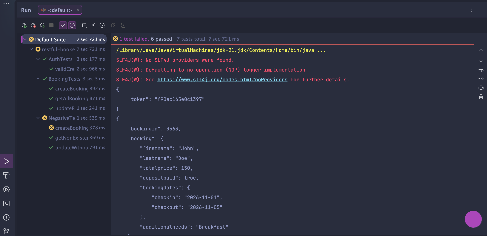

# Restful-Booker API Tests

Automated API tests for the [Restful-Booker](https://restful-booker.herokuapp.com/apidoc/index.html) practice API, written in Java with RestAssured and TestNG.

## Tech stack
- Java 21
- Maven
- RestAssured
- TestNG
- Jackson (DTOs for request bodies)

## How to run
```
mvn test
```

## Test coverage

**Positive tests**
- Get all bookings returns 200 and a non-empty list
- Valid login returns a token
- Create booking: the response contains the same data that was sent
- Update booking (PUT) with a token: the changes are saved
- Delete booking with a token: the booking can no longer be found (404)

**Negative tests**
- Update without a token returns 403
- Get a non-existent booking returns 404
- Create a booking with missing fields: expected 400 (**fails, see Bug 2**)

## Test results
7 passed, 1 failed (the failure is a known bug, see below).



## Bugs found

### Bug 1: DELETE returns the wrong status code
- **Endpoint:** DELETE /booking/{id}
- **Steps:** create a booking, get a token, send DELETE with the token
- **Expected:** 200 OK or 204 No Content
- **Actual:** 201 Created
- **Severity:** Low (the booking is deleted, but the status code is misleading)

### Bug 2: invalid input causes a server error
- **Endpoint:** POST /booking
- **Steps:** send a body containing only `{"firstname": "John"}`
- **Expected:** 400 Bad Request
- **Actual:** 500 Internal Server Error
- **Severity:** Medium (the server doesn't validate input and crashes instead)

## Project structure
- `base/BaseTest`: base URL setup and helper methods (get token, create booking)
- `models/`: DTOs for the booking request body
- `tests/`: test classes (BookingTests, AuthTests, NegativeTests)